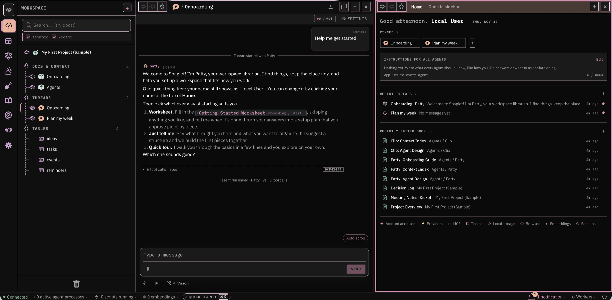

# Snaglet

Snaglet is a desktop app where you and a team of AI agents share one workspace: threads, docs,
tables, a calendar, automations and your project folders. Everything it stores stays on your
machine.

[Download for macOS](https://snaglet.com) · macOS 14+ on Apple Silicon · [MIT license](LICENSE)



## The problem—and how Snaglet addresses it

**Currently, AI agents can do more than ever—but the way we work with them hasn’t caught up.**

| The problem                                                                                                                                                        | With Snaglet                                                                                                                                                                                                   |
| ------------------------------------------------------------------------------------------------------------------------------------------------------------------ | -------------------------------------------------------------------------------------------------------------------------------------------------------------------------------------------------------------- |
| **Work is scattered.** Files, chat histories and disconnected tools leave you carrying information between agents and digging for past decisions.                  | **A connected workspace.** Organize conversations, docs and tables around projects. Agents can search previous work instead of relying only on the current conversation.                                       |
| **Different kinds of knowledge become one pile of context.** Discussions, reference material, structured records and learned preferences serve different purposes. | **Different homes for different context.** Threads hold conversations, docs hold written knowledge, tables organize structured records, and private agent memories retain preferences and lessons across runs. |
| **Humans need more than an output to review.** It can be difficult to inspect the information agents use, edit shared context or redirect the work.                | **An interface for working alongside agents.** Explore and organize information, edit shared docs and records, and participate in project conversations.                                                       |
| **Cloud-based workspaces keep your knowledge in someone else’s service.**                                                                                          | **A database on your machine.** Snaglet stores workspace data locally. Project files stay on disk and can be linked to the workspace.                                                                          |
| **A fixed agent setup may not fit your work.** You need control over the team, models and tools you use.                                                           | **A team you configure.** Choose agents’ roles, instructions, models and tool access. Work with one agent or several, and connect external tools and clients through MCP.                                      |

_Local storage does not mean every interaction stays offline: hosted models and external tools
receive the information sent to them. See [Network access](SECURITY.md#network-access)._

## Features

One page per part of Snaglet. Each covers how to use it and how it is built.

| Part                        | Page                                     | In short                                                      |
| --------------------------- | ---------------------------------------- | ------------------------------------------------------------- |
| Threads and direct messages | [Threads](docs/threads.md)               | Talk with one agent or several; agents mention each other     |
| Docs                        | [Docs](docs/docs.md)                     | Markdown docs with saved versions, links and chips            |
| Tables                      | [Tables](docs/tables.md)                 | Tables you design: grid and board views, relations, repeats   |
| Calendars and reminders     | [Calendars](docs/calendars.md)           | Events, table dates and reminders on one timeline             |
| Projects and linked folders | [Projects](docs/projects.md)             | Group related work and link a folder on disk                  |
| Agents                      | [Agents](docs/agents.md)                 | Roles, instructions and models you choose per agent           |
| Tools                       | [Tools](docs/tools.md)                   | What agents can do, and which tools ask you first             |
| Memories                    | [Memories](docs/memories.md)             | What each agent remembers between runs                        |
| Prompt caching              | [Prompt caching](docs/prompt-caching.md) | How requests are laid out so providers can reuse them         |
| Automations                 | [Automations](docs/automations.md)       | Wake an agent on a schedule                                   |
| Hooks                       | [Hooks](docs/hooks.md)                   | Run your own TypeScript when something changes                |
| Search                      | [Search](docs/search.md)                 | Keyword and meaning search, all on your machine               |
| The interface               | [The interface](docs/ui.md)              | Panes, shortcuts, archive and theme                           |
| Backups                     | [Backups](docs/backups.md)               | Snapshots, restore and reset                                  |
| Model providers             | [Providers](docs/providers.md)           | Hosted providers or local models through Ollama or LM Studio  |
| MCP, both ways              | [MCP: client and server](docs/mcp.md)    | Agents use MCP servers; outside MCP clients use the workspace |

## Install

1. Download the latest `.dmg` from [snaglet.com](https://snaglet.com) or the
   [releases page](https://github.com/snaglet-org/snaglet/releases/latest).
2. Open it and drag **Snaglet** into **Applications**.
3. Open Snaglet.

- You need macOS 14 or later on Apple Silicon. Nothing else: Snaglet brings its own database.
- 16 GB of memory is recommended if you link large folders. See [Status](docs/status.md).
- The app is signed and notarized by Apple.
- Your data lives in `~/.snaglet`.
- Snaglet tells you when a newer release is out. Click the notification, or open
  **Settings → Updates**, to install it and restart; your data stays.

### Run from source

For development, with Node.js 22 or newer, Corepack and Apple's Command Line Tools
(`xcode-select --install`):

```bash
git clone https://github.com/snaglet-org/snaglet.git
cd snaglet
corepack enable
pnpm install
pnpm dev
```

Then open <http://localhost:3001>. A source checkout keeps its data in `~/.snaglet-dev` and its
credential key in the checkout's `.env`. Everything else, including building your own copy of the
app, is in [Development environment](docs/dev-environment.md).

## First steps

1. Connect a model provider on **Get started**: a subscription you already have, an API key, or
   a local server such as Ollama or LM Studio.
2. Say hello to Patty, the starter agent who helps you set up, in her **Onboarding** thread.
3. Create a thread from the Workspace **+** menu, add an agent, and send a message.

The pages under [Features](#features) cover the rest of the app.

## Your data

- Everything lives in the Snaglet home: the database, snapshots, images, skills, hooks, logs and
  downloaded models. Linked project folders stay where they are.
- **Settings → Backups** creates snapshots, exports a portable SQL copy and restores a snapshot.
- Don't keep the Snaglet home in iCloud Drive, Dropbox or another sync folder: syncing a running
  database can corrupt it.
- Back up the credential key with your data: `credential.key` in the Snaglet home, or
  `CREDENTIAL_ENCRYPTION_KEY` in a source checkout's `.env`. Saved credentials can't be read
  without it.

Network access, what agents can do with your account, and how to report a vulnerability are in
[SECURITY.md](SECURITY.md). Read it before you give agents broad access.

## Uninstall or reset

- **Reset from inside Snaglet.** **Settings → Backups → Reset to clean slate…** wipes workspace
  content, after taking a snapshot.
- **Remove a source checkout's data.** Stop `pnpm dev`, then delete `~/.snaglet-dev` and the
  checkout's `.env` together.
- **Remove the app.** Quit Snaglet, then delete `Snaglet.app`, `~/.snaglet`, `~/.snaglet.json`,
  `~/.local/bin/snaglet` and `~/Library/Application Support/com.snaglet.app`. If you moved the Snaglet home,
  delete the folder that `homePath` in `~/.snaglet.json` points to instead of `~/.snaglet`.

## Documentation

Every page is listed in [docs/INDEX.md](docs/INDEX.md). What works today and what is in progress
is in [Status](docs/status.md), and changes are in the [Changelog](CHANGELOG.md).

## Getting help

Open a [GitHub issue](https://github.com/snaglet-org/snaglet/issues) with your macOS version, how
you run Snaglet, the steps that cause the problem, and the relevant lines of `logs/server.log` in
your Snaglet home. Check the log for anything private before you paste it. Report security issues
as [SECURITY.md](SECURITY.md) describes, not in a public issue.

## Contributing

Issues and pull requests are welcome. Read [CONTRIBUTING.md](CONTRIBUTING.md) and the
[Code of Conduct](CODE_OF_CONDUCT.md) first.

## License

[MIT](LICENSE). Third-party notices are in [NOTICE](NOTICE).
