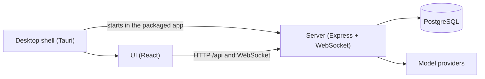

# Architecture

This page explains how Snaglet is built: the processes that run, where data lives, how the data model
fits together, how a message wakes agents, and how changes reach the UI. Each section names the
code to open next; details live in code comments.

How agents build their prompt, call tools, run subagents and keep memory is in
[agents.md](./agents.md). Setup and commands are in
[dev-environment.md](./dev-environment.md).

## Repository layout

```text
apps/
  desktop/        Tauri desktop shell (Rust, in src-tauri/src/)
  desktop-ui/     React + Vite UI
  server/         Express + WebSocket server and the agent runtime
packages/
  db/             Raw SQL models, migrations, PostgreSQL runtime, backups
  shared/         Types, constants and utilities shared by server and UI
  snaglet-sdk/    SDK that hooks and custom tools import (`@snaglet/sdk`)
  snaglet-cli/    The `snaglet` command line
  theme/          The default color theme as data (`@snaglet/theme`)
  ui/             Shared React components
tests/
  unit/           Jest unit tests
  integration/    Jest tests against disposable managed PostgreSQL databases
  e2e/            Playwright and built-app end-to-end tests
  build/          Build and release contract tests
build/scripts/    Desktop packaging scripts
scripts/          Repo scripts: dev setup, lint gates, migrations
```

Apps may import packages. Packages do not import app code.

## Processes

Snaglet runs as three parts: a desktop shell, a Node server and a web UI. The server owns everything
with state: the database, agent runs, tools, providers and background work.



| Area   | Development (`pnpm dev`)                                | Packaged app                                            |
| ------ | ------------------------------------------------------- | ------------------------------------------------------- |
| UI     | Vite dev server on `CLIENT_PORT` (default 3001)         | Static files served by the server                       |
| Server | `pnpm dev:server` on `PORT` (default 4001)              | Sidecar the shell starts on a loopback port             |
| Data   | `~/.snaglet-dev`, or an external `SNAGLET_DATABASE_URL` | `~/.snaglet` or a moved home, always managed PostgreSQL |
| Auth   | Local dev configuration                                 | Per-session token on every `/api` and WebSocket call    |

`pnpm dev:desktop` opens the Tauri window against the dev UI and dev server; in that mode the
shell starts no sidecar.

macOS on Apple Silicon is supported. Windows support is in progress
([windows-development.md](./windows-development.md)). Linux does not work yet
([linux-development.md](./linux-development.md)).

### The desktop shell

The packaged shell (`apps/desktop/src-tauri/src/main.rs` and `sidecar.rs`) shows a splash window,
locks the Snaglet home so only one app owns it, checks the bundled PostgreSQL runtime, and starts the
Node server on a loopback port with session tokens. It strips inherited database variables, so
the environment can never point a user's app at other data. When `/health` answers, it opens the
UI with the API address and token.

The shell never kills a slow server, because a large database upgrade can take minutes. On quit
it asks the server to shut down, waits for Node to exit, then stops the PostgreSQL cluster it owns
and releases the lock. Server logs are in `<SNAGLET_HOME>/logs/server.log`; the server's raw console
output, including errors from before the logger starts, is in `<SNAGLET_HOME>/logs/sidecar.console.log`.

### The server

`apps/server/src/index.ts` sets up middleware, mounts every `/api/...` route, starts the
WebSocket services, connects the database and starts background work.

- `apps/server/src/domains/<name>/` holds feature code, usually a `*.routes.ts` file beside its
  services (agents, calendar, containers, docs, projects, reminders, tables, threads and more).
- `apps/server/src/routes/` holds cross-cutting routes (health, providers, models, settings,
  archive, palette search, hooks, automations, voice).
- `apps/server/src/services/` holds the runtime: dispatch, tools, providers, search, embeddings,
  scheduling.

| Background service                          | What it does                                            |
| ------------------------------------------- | ------------------------------------------------------- |
| `services/ScheduleService.ts`               | Fires automations and scheduled hooks                   |
| `domains/reminders/reminderScheduler.ts`    | Fires calendar reminders                                |
| `services/ArchiveTtlSweeper.ts`             | Removes expired archived items and orphaned row repeats |
| `workers/EmbeddingWorker.ts`                | Embeds content that is missing or out of date           |
| `services/fileIndexing/`                    | Watches linked project folders and indexes their files  |
| Hook, skill and custom-tool folder scanners | Build and register what is saved under the Snaglet home |

Only one server should run background work against a database; set
`RUN_BACKGROUND_WORKERS=false` on any second one. Automatic local model work (loading the local
embedder at boot, embedding as content changes) is a separate opt-in, `SNAGLET_LOCAL_INTELLIGENCE=true`
(`apps/server/src/config/localIntelligencePolicy.ts`). The packaged app turns it on.

### The UI

The UI is a React app in `apps/desktop-ui/src/`.

- `pages/Dashboard/` is the main shell: `layout/` (panes), `chrome/`, `selection/`, `sidebar/`
  (activity-bar views) and `views/` (pane contents). `views/DetailRouter.tsx` picks the view for
  the selected item.
- `features/` holds larger features: workspace tree, rich markdown editor, calendar, automations,
  reminders, Database tables.
- `utils/api/` holds typed API clients; `ws/` holds the WebSocket provider and the workspace event
  bridge.

### The color theme

`@snaglet/theme` (`packages/theme/`) holds the default theme, Soft Pastel Garden, as one typed
constant in `src/index.ts`, with no runtime dependencies. Its generate script writes the package
entry (`index.js`, `index.d.ts`), `defaultTheme.json` (token key to color), `theme.css` and
`tokens.scss` (the app's whole color layer: the palette, the tokens derived from it and every
`--color-*` role), and they are committed. The UI's stylesheet loads `tokens.scss`
(`packages/ui/styles/_tokens.scss`), the shared token list and the server's reset take their
defaults from the constant, `index.html` and the native windows paint its canvas color first, and
the website syncs its colors from `defaultTheme.json`. Change a default color in `src/index.ts`,
then run `pnpm --filter @snaglet/theme generate`; `pnpm --filter @snaglet/theme check` (and the
package's unit test) fails while a committed file is stale. See
[packages/theme/README.md](../packages/theme/README.md).

A saved theme (`appearance.colors`) holds only the colors someone changed, set inline on the root
element (`utils/workspaceTheme.ts`). The app re-derives the derived tokens (text on Selected, the
hover tint, `color-scheme`) for the saved colors, so any palette stays readable.

## Snaglet home and PostgreSQL

### The Snaglet home

All local data lives in one folder, the Snaglet home: `SNAGLET_HOME` when set, else the `homePath` in
`~/.snaglet.json`, else `~/.snaglet`. `pnpm dev` uses `~/.snaglet-dev`. `apps/server/src/services/snagletHome.ts`
creates the folders:

```text
<SNAGLET_HOME>/
  postgres/       managed PostgreSQL cluster
  backups/        snapshots and their manifests
  projects/       one symlink per project to its linked folder
  hooks/          hook source, one folder per hook
  build/hooks/    compiled hook bundles
  skills/         skills, one folder each with a SKILL.md
  tools/          custom tool workspaces
  images/         stored image bytes, one file per image
  models/         downloaded local models
  logs/           server and sidecar logs
```

Do not keep a live Snaglet home in a file-sync folder such as iCloud or Dropbox. File-level sync can
corrupt a running database.

### Managed and external PostgreSQL

Snaglet talks to PostgreSQL through the `DbClient` interface (`packages/db/adapters/types.ts`),
implemented by `PostgresAdapter`. There are two modes:

- **Managed** (the default). Snaglet starts or adopts its own PostgreSQL 17 cluster with pgvector under
  `<SNAGLET_HOME>/postgres`. The desktop app bundles the runtime. A source checkout downloads
  checksum-pinned PostgreSQL and pgvector source and compiles them into its cache on macOS and
  Linux, and downloads prebuilt PostgreSQL binaries on Windows. No system PostgreSQL or Docker is
  needed.
- **External.** `SNAGLET_DATABASE_URL` points at a database you run. Snaglet creates the schema in an empty
  database and `pnpm db:migrate` applies later migrations, but Snaglet never starts or stops it. This
  is for development and CI only; the packaged app ignores it.

There is no ORM. Application code calls `getDb()` and the models under `packages/db/tables/`.
Direct `pg` imports stay inside `packages/db`.

### Boot and migrations

On boot the server creates the cluster and schema if they are missing, or connects and finishes
any interrupted restore. Migrations are numbered SQL files in `packages/db/migrations/`.
`0001_init.sql` is the baseline: the complete initial schema followed by the built-in rows (the
catalog seeds from `seeds/` and the feature flags). Later changes are new files (`0002_...` onward).
Each file and its ledger row commit in one transaction, so a failed file rolls back and can be
retried.

- The packaged app takes a snapshot, then applies pending migrations.
- A source checkout leaves them pending until you run `pnpm db:migrate`; `/health` reports them.
- An older build refuses to open data from a newer one, and a build refuses a database whose
  ledger names a migration it does not ship.

Never edit a released migration, `0001_init.sql` included; add a new one. A change to catalog rows
also updates the matching file in `packages/db/migrations/seeds/`, which `ensureBuiltinCatalog`
replays on every boot. Never run two Snaglet servers that write to the same
database.

### Snapshots and restore

Backups are manual. A snapshot is a `pg_dump` plus a JSON manifest under `<SNAGLET_HOME>/backups`,
written when a person asks in Settings, and as a safety copy before a packaged migration, a reset
or a restore. A restore first snapshots the current database, restores into a scratch database,
checks it, then swaps database names; if a check fails, the original stays. Code:
`apps/server/src/services/DatabaseBackupService.ts`, `packages/db/runtime/postgres/restore-swap.ts`.

### Agent SQL roles

SQL that agents write never runs as the app user. Each SQL tool has its own locked-down
PostgreSQL role: one reads only user tables, one also reads an allowlist of system tables, and one
writes only user tables. The allowlist is `WORKSPACE_READER_POLICY` in
`packages/db/runtime/postgres/workspaceReader.ts`. **A migration that adds a `public` table must
classify it there**; `tests/integration/packages/db/workspaceReaderRole.test.ts` fails until it
does.

## Data model

### The nodes spine

Most things users see are rows in `nodes`, the shared table for identity and placement, plus a
kind-specific table for their content.

- `nodes.type` is one of `container`, `doc`, `thread`, `message`, `memory`, `thread_summary`,
  `file`, `image`, `tool` or `calendar_event`.
- `nodes.container_id` is the parent in the workspace tree; `nodes.sort_order` orders siblings.
- `nodes.project_id` is the project a thread belongs to, or null.
- `nodes.archived` is the archive state. Archive and restore rules are largely SQL triggers in the
  migrations, so check them after any schema change.

`links` records references between nodes, such as chips in a doc. `ContainerTreeService.ts`
(`apps/server/src/domains/containers/`) builds the tree the UI shows. Agents are not nodes: they
are actors with their own `agents` table.

An image's bytes live in `<SNAGLET_HOME>/images` under the key stored in `images.url`: `<id>.<ext>`
for a new image, `<name>-<id>.<ext>` once it is renamed. Older rows keep an inline `data:` URL
instead. Read the key from the row through `ImageModel`; never build it from the id.
`ImageModel.rename` gives the bytes the new key before the row changes and removes the old key
only after the commit, so the row always names a file that exists.

### Containers, projects, threads and docs

- **Containers** (`containers`) are folders in the workspace tree. A project is a container with
  `category = 'project'`; there is no projects table. Project details such as the linked local
  folder (`folder_path`) are columns on `containers`, read through
  `packages/db/tables/projects/ProjectModel.ts`. A folder can become a project, but a database
  trigger stops a project from turning back into a folder, because threads and tables point at it.
- **Threads** (`threads`) belong to a project or to none, and never sit inside a folder.
  `threads.kind` is `chat` or `dm`. Members and their per-thread overrides are in
  `thread_participants`; messages are in `messages`. Thread digests and compacted history are in
  `thread_summaries`, and agent memory in `memories`.
- **Docs** are markdown in `docs`, with saved versions in `doc_snapshots`
  (`packages/db/tables/docs/DocModel.ts`, `apps/server/src/domains/docs/`).

### Database tables

Users make their own tables. A task, for example, is a row in such a table; there is no separate
tasks table.

- `table_catalog` lists every table. `origin` is `builtin` (Snaglet's own `public` tables, read-only
  here) or `custom`. `project_id` gives a custom table a project home. A table an agent creates
  with the `table` tool starts in the calling thread's project, like a doc or thread it creates;
  a `set_project` op in the same call overrides that, and a call with no thread (MCP, hooks, the
  SDK) creates it workspace-wide.
- Each custom table is a real PostgreSQL table in the `user_tables` schema, named what the user
  named it. Each field is a real column; `id`, `created_at` and `position` are system columns.
- `table_fields` is the registry over those columns: stable field id, type, options, relation
  target, display order and calendar binding. APIs key values by field id, never by column name.
- `table_history` keeps one undo stack per actor (the user, each agent, each external client), up
  to 100 steps. Every change to a custom table records a step in the same transaction.
- Archiving or deleting a table or field renames it to a tombstone named after its id
  (`_snaglet_<id>`), which frees the name at once. A deleted item is dropped for good when its undo step
  leaves the history.

Code path: `apps/server/src/routes/tables.ts` → `apps/server/src/domains/tables/` →
`packages/db/tables/table_*`. Wire types are in `packages/shared/types/tables.ts`,
`table-entries.ts` and `table-history.ts`.

### Calendar, repeats and reminders

The calendar copies nothing. `GET /api/calendar/occurrences`
(`apps/server/src/domains/calendar/occurrences.ts` and `automationOccurrences.ts`) merges three
sources onto one timeline:

- **Events** in `calendar_events`, each backed by a `calendar_event` node. Timed events store
  instants plus a time zone; all-day events store dates.
- **Table rows**, through a date field bound to a calendar (`table_fields.calendar_id`).
- **Automations** placed on a calendar.

`calendars` holds the calendars with their time zone and color. The calendar changes rows only
through the table API, so every change is an undo step.

A repeating row keeps one date that always holds its current occurrence; completing or skipping
it moves that date on. `table_fields.recurrence` is the field's repeat setting,
`table_entry_repeats.value` holds each row's `{ rrule, dtstart, current, tz }`, and
`table_entry_occurrences` logs `done`, `skipped` and `moved` occurrences. The repeat engine is
shared code (`packages/shared/utils/tableRecurrence.ts`, `tableRepeatSpec.ts`); event repeats use
it too (`apps/server/src/domains/calendar/eventRepeat.ts`).

Reminders live in `reminder_settings` (one row per item) and `reminder_deliveries` (a ledger, so
each reminder fires once). `apps/server/src/domains/reminders/reminderScheduler.ts` fires them.

### Automations and hooks

An **automation** is a scheduled agent wake: a row in `automations` (agent, thread, prompt,
timing) plus one row in `schedules`. `ScheduleService` claims due schedules and calls
`AutomationService.fire`, which posts `[automation <name>] @Agent <prompt>` in the thread and
dispatches it like a user message. Runs are logged in `schedule_runs`. Timing rules are in
`packages/shared/utils/automationTiming.ts`.

A **hook** is an event-triggered TypeScript script saved at `<SNAGLET_HOME>/hooks/<name>/hook.ts`. It
default-exports `defineHook({ on, filter, schedule, run })` from `@snaglet/sdk`. The hook scanner
(`apps/server/src/services/customHooks/HookRegistryService.ts`) builds each folder into
`<SNAGLET_HOME>/build/hooks/`, registers it in `hook_registrations` (disabled until someone enables
it), subscribes it to its events and writes its schedules to `schedules`. Each run is a child
process (`hookRunner.ts`) logged in `hook_runs`. Event types are in `packages/snaglet-sdk`.

The Automations view lists automations and hooks together.

### Changing the schema

1. Add a migration in `packages/db/migrations/`.
2. Update the model in `packages/db/tables/<table>/`.
3. Update shared types in `packages/shared/types/` when the shape crosses server and UI.
4. Classify any new `public` table in `WORKSPACE_READER_POLICY`.
5. Add route or service tests, then run `pnpm --filter @snaglet/db pg:migration:verify`.

## Message dispatch

```text
UI sends socket:chat:send
  -> chatHandlers.ts validates and saves the message
  -> buildDispatchSet.ts picks the agents to wake
  -> dispatchToThread.ts runs waves
       -> each woken agent runs one turn (runAgentTurn.ts -> turnLoop.ts)
       -> replies are saved; mentions in them can start the next wave
  -> the conversation ends with a stop reason
```

These files are under `apps/server/src/services/SocketService/`. The turn itself (context, model
call, tool loop) is in [agents.md](./agents.md).

**Who is woken.** Each thread has a dispatch mode (`threads.dispatch_mode`, `mentioned` by
default). In `all`, every agent in the thread answers and mentions are only context. In
`mentioned`, only mentioned agents answer; with no mention, a one-agent thread wakes its agent and
a group thread wakes no one (the sender gets a `socket:chat:dispatch_hint`). The agent count
leaves out archived agents (`dispatch/partitionArchivedParticipants.ts`), and a one-agent thread
does not parse mentions at all. The message that starts a conversation may mention at most four
of the thread's agents, in either mode (`MAX_AGENTS_PER_MESSAGE` in
`services/groupChat/safety.ts`); over that, it is saved, nobody is woken and the sender gets an
error. Mentions in agents' replies, and in a message that reaches a run already in progress, are
not held to that limit; the per-agent dispatch ceilings bound them instead.

**Waves and budgets.** A wave is one round of agent turns; mentions in its replies wake agents for
the next one. `ConversationBudget.ts` tracks everything one user message starts. Output tokens
come from a shared pool: when it runs out, no new turn starts, but a reply is never cut short. A
wave cap is optional and off by default, so the token pool is the guard against runaway loops.
Thread overrides are columns on `threads`, resolved in `services/ConfigResolverService.ts`.

**Stop reasons.** Every conversation ends with a `ConversationStopReason`
(`packages/shared/types/conversation.ts`):

| Reason                      | Meaning                                           |
| --------------------------- | ------------------------------------------------- |
| `all-passed`                | Every agent passed, so no agent is left to run    |
| `stagnation`                | An agent kept repeating itself                    |
| `wave-cap`                  | The thread's wave cap was reached                 |
| `token-budget`              | The output-token pool ran out                     |
| `user-abort`                | A person, MCP client or agent stopped the run     |
| `reaper`                    | The run watchdog released a stuck run             |
| `summary-model-unavailable` | The summary model the thread needs is unavailable |
| `error`                     | The wave loop threw                               |

An agent passes when it ends a reply with `[PASS]` or `[DONE]`, replies and is not mentioned again
in that wave, repeats itself, reaches its dispatch ceiling, or is stopped or fails on its own
(`ConversationPassKind`); a one-agent thread ends `all-passed` after its reply. The chat shows the
ending as `[conversation ended · <reason copy> · waves: N · output tokens: N]`
(`emitConversationEndedEvent` in `SocketService/threadEvents.ts`, copy in
`CONVERSATION_STOP_REASON_COPY`). `dispatch/dispatchRunTeardown.ts` skips that line when no agent
ran, after an `all-passed` or `stagnation` ending in a one-agent thread, and for `user-abort`,
`reaper` and `summary-model-unavailable`, which already wrote their own line.

**One run per thread.** `services/ActiveRunTracker.ts` allows one active run per thread. A message
that arrives during a run is saved, then queued, and the active run picks it up.

**Dispatch from tools and automations.** Tools, automations and MCP clients enter the same
`dispatchToThread` (`dispatch/buildDispatchDeps.ts` builds its dependencies outside a socket).
They save and broadcast their message first, then start the wake without waiting. The `thread`
tool's `send` op (`services/ToolService/handlers/threads/threadSend.ts`) returns
`dispatch: { initiated: true }` at once. Never await a dispatch in a tool handler: the calling
agent would block for the whole target conversation.

## Realtime events

When something users can see changes, the server tells every connected client on the WebSocket
`workspace` channel.

- Wire schema: `packages/shared/types/workspace-events.ts` (`WorkspaceEvent`).
- Server helpers: `apps/server/src/realtime/surfaces/` (`tree.ts`, `threads.ts`, `tables.ts`,
  `calendar.ts`, `automations.ts` and others).
- Client: `apps/desktop-ui/src/ws/useWorkspaceEventBridge.ts` receives events, and
  `apps/desktop-ui/src/utils/workspaceEvents.ts` is the in-app event bus.

**The rule:** never import `realtime/emit` directly; call a helper in `realtime/surfaces/`, which
builds a typed event. `pnpm lint:realtime` (part of `pnpm lint`) fails when any other file imports
the emitter.

To add a mutation site, call the matching helper right after the database write commits, never
before and never after a failed write. Send a patch with only the fields that changed, because
clients treat every field in a patch as a change. For a doc body save, use `emitDocBodySaved`.

To add an event type, add the variant to `WorkspaceEvent`, extend `isWorkspaceEvent`, add a
surface helper, and handle it in the client bridge. The bridge's exhaustive switch fails the
typecheck until you do.

Each event carries the actor that caused it, bound in `apps/server/src/realtime/actorContext.ts`:
the agent turn wraps tool calls, middleware wraps authenticated HTTP requests, and everything else
is the system actor. Tool authors do not bind it themselves.

### Agent changes

Agents are not tree nodes, so they have their own event: `agent.updated`
(`realtime/surfaces/agents.ts`). It carries the agent id, `changed` (the fields that really
changed, `skills` for the agent's general skills, or `created` / `deleted`) and `updatedAt`, the
agent row's revision after the write. It carries no field values: receivers refetch the agent.
Every write that changes an agent sends it, whichever path made it: the agent pane, the
`update_agent` tool, the tool assignment routes, an "Always allow" answer
(`services/agentToolAllowList.ts`), credential and MCP server changes, and skill assignments. A
new agent write path must send it too. Use `emitAgentRowChanges` with the row read back after the
write, so the revision is the new one; leave the revision out when the write does not bump
`updated_at` (archive and restore do not).

In the app, the bridge puts each `agent.updated` on the agent bus (`utils/agentEvents.ts`), and
sends `agents.invalidated` after every reconnect, because events missed while offline are not
replayed. An open agent pane (`views/AgentView/useLiveAgent.ts`) refetches its agent on either,
waits for its own saves first, and skips an event whose revision it already holds (its own
save's echo). A field the user is not editing takes the new value with a brief highlight. A text
field they are editing (role, identity, system prompt) keeps their text and shows "Updated by …
just now" with Reload and Keep mine; nothing is saved over the other change until they pick.
Saves of a text field also wait from the moment an event names it until its refetch lands, so a
draft cannot overwrite a change the pane has not seen yet. The sidebar roster and pane titles
follow the same events.

## Search and embeddings

Search has two entry points: the agent `search` tool
(`apps/server/src/services/ToolService/tools/workspace/search/`) and the command palette
(`POST /api/search/palette`, `apps/server/src/routes/palette-search.ts`). The sidebar's
workspace search and `@` mention search call the palette endpoint too, so the palette rules
below apply to all three.

| Mode       | How it works                                          |
| ---------- | ----------------------------------------------------- |
| `keyword`  | PostgreSQL full-text search plus a trigram name match |
| `semantic` | Nearest stored vectors                                |
| `hybrid`   | Keyword and vector results fused by reciprocal rank   |

- The shared core is `apps/server/src/services/search/core.ts` (`searchWorkspace`) and
  `nodeSearch.ts`.
- The palette shows keyword results as the user types, then adds hybrid results. It never runs
  the reranker, so typing stays fast. It applies no similarity floor: an unfiltered search lists
  its keyword matches plus the five closest matches found only by meaning, across workspace items
  and indexed files together (`PALETTE_MEANING_MATCH_LIMIT`). A filtered search such as `doc:` or
  `file:` lists meaning matches up to its normal limit.
- The agent tool defaults to hybrid. Its extra lanes (memories, images, files, thread summaries,
  code) are in `services/ToolService/handlers/search/workspaceSearch/`. A committed semantic or
  hybrid search reranks its results with a local cross-encoder only when the server-only
  `reranker` feature flag is on. It is off by default, so the hybrid order stands and the
  relevance floor that needs reranker scores does not apply
  (`services/reranking/reorderByRerank.ts`).
- Callers pass kinds, scope, time range and ordering as parameters. A few fixed parsers read the
  query text: time phrases ("next month") in table-row search, a trailing `in "Project"` scope in
  the palette, and a thread-recall trigger in the agent's semantic lane.
- Table rows are searched by keyword across custom tables
  (`packages/db/tables/table_entries/entrySearch.ts`) and, for tables with it on, by meaning
  (`table_semantic_search`, `table_entry_embeddings`). It is on by default up to 10,000 rows: a
  new table gets its `table_semantic_search` row at creation, and older tables got theirs once at
  boot (`services/tableSemantic/defaultOn.ts`, marker setting `search.table_semantic_default_on`).
  A bigger table needs a person's `confirm`, and the cap holds as a table grows: the sweep skips a
  table past it with no `confirmed_rows` (its vectors stay) until someone confirms. A table a
  person turned off is kept in the `search.table_semantic_off` setting so the default never turns
  it back on.
- Code search uses ripgrep when it can and falls back to plain-text matching
  (`services/ToolService/handlers/search/codeSearch.ts`).

Ranking is deterministic, so a ranking change needs a regression case in
`tests/integration/apps/server/search/`. Full-text search is English-only.

`embeddings` stores vectors for docs, messages, memories, thread summaries, files and other
nodes. Snaglet embeds with one engine, a built-in local ONNX model
(`apps/server/src/services/embedding/LocalEmbedderService.ts`) downloaded into
`<SNAGLET_HOME>/models`; it needs no credential. With `SNAGLET_LOCAL_INTELLIGENCE=true`, content embeds as
it is written and `workers/EmbeddingWorker.ts` sweeps every minute for anything missing or stale.

## Feature flags

A feature flag shows or hides a UI surface. It is not an access check: routes enforce their own
rules. Flags are rows in `feature_flags`, seeded by a migration: `false`, except `hub_home`, which ships on. The UI reads them from
`GET /api/feature-flags` (`apps/server/src/services/FeatureFlagService.ts`) through
`useFeatureFlag` (`apps/desktop-ui/src/features/featureFlags/FeatureFlagsContext.tsx`), sees only
the names in `FRONTEND_FEATURE_FLAG_NAMES` (`packages/shared/types/feature-flags.ts`), and fails
closed: an error or a missing row means off.

| Flag                     | Shows                                                                                       |
| ------------------------ | ------------------------------------------------------------------------------------------- |
| `local_model_removal_ui` | Remove and Clear controls for local models in Settings                                      |
| `cli_pane_ui`            | The Command line row in Settings and its installer pane                                     |
| `fallback_credentials`   | Primary, fallback and rotation controls on provider keys                                    |
| `hub_home`               | The Home pane, opened when no other pane is open, with Get started beside it on a first run |

To add one, seed it in a new migration with `ON CONFLICT (name) DO NOTHING`, add the name to
`FRONTEND_FEATURE_FLAG_NAMES`, and list it here. To turn one on locally, set `enabled = true` on
its row in your dev database.

A server-only flag gates server behavior instead and never reaches the UI.
`featureFlagService.isServerFlagEnabled` reads it, caches the value for 30 seconds, and treats a
missing row as off, so it needs no seed. The one server-only flag is `reranker`, which turns on
the local search reranker and its model download (see
[Local models](dev-environment.md#local-models)).

## Where to start

UI paths are under `apps/desktop-ui/src/`; server paths are under `apps/server/src/`.

| Change                               | Start here                                                                                         |
| ------------------------------------ | -------------------------------------------------------------------------------------------------- |
| Add or change an API route           | `domains/<name>/` or `routes/`; every base path is mounted in `index.ts`                           |
| Change the schema                    | [Changing the schema](#changing-the-schema)                                                        |
| Change who answers a message         | `services/SocketService/dispatch/dispatchToThread.ts`, `handlers/chatHandlers/buildDispatchSet.ts` |
| Change an agent turn, prompt or tool | [agents.md](./agents.md)                                                                           |
| Show a change live in the UI         | `realtime/surfaces/`, `ws/useWorkspaceEventBridge.ts`                                              |
| Add a pane or view                   | `pages/Dashboard/views/DetailRouter.tsx`, then the view folder                                     |
| Workspace tree                       | `domains/containers/ContainerTreeService.ts`, `features/workspace-tree/`                           |
| Database tables                      | `domains/tables/`, `packages/db/tables/table_*`, `pages/Dashboard/views/TableView/`                |
| Calendar and reminders               | `domains/calendar/`, `domains/reminders/`, `features/calendar/`                                    |
| Row repeats                          | `packages/shared/utils/tableRecurrence.ts`, `packages/db/tables/table_entries/repeats.ts`          |
| Automations                          | `services/automations/`, `services/ScheduleService.ts`, `features/automations/`                    |
| Hooks                                | `services/customHooks/`, `packages/snaglet-sdk`                                                    |
| Search                               | `services/search/`, `routes/palette-search.ts`, `services/ToolService/handlers/search/`            |
| Snaglet home, backups, restore       | `services/snagletHome.ts`, `services/DatabaseBackupService.ts`, `packages/db/runtime/postgres/`    |
| Desktop shell or packaging           | `apps/desktop/src-tauri/src/`, `build/scripts/`, [release-process.md](./release-process.md)        |
| Default colors or the theme          | `packages/theme/src/`, then `pnpm --filter @snaglet/theme generate`                                |
| Providers or MCP                     | [providers.md](./providers.md), [mcp.md](./mcp.md)                                                 |

Before you open a pull request, run the checks in [dev-environment.md](./dev-environment.md), at
least `pnpm verify:changed`. Run `pnpm lint:realtime` after changing how events are emitted, and
`pnpm --filter @snaglet/db pg:migration:verify` and `pnpm --filter @snaglet/server db:backup:verify` after changing migrations, boot or backups.
Code style is in [conventions.md](./conventions.md).
