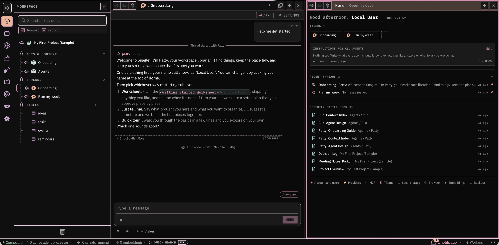

# Getting started

Install Snaglet, connect a model, and say hello to your first agent.

## Install

- **macOS 14 or later on Apple Silicon** is supported, with 16 GB of memory recommended if you link
  large folders ([Status](./status.md)). Windows is
  [in progress](./windows-development.md) and Linux [does not work yet](./linux-development.md).
- Download the app from [snaglet.com](https://snaglet.com), open the `.dmg` and drag **Snaglet**
  into **Applications**. To run from source instead, see [Install](../README.md#install).
- You do not install a database, Docker or anything else. On its first run Snaglet creates its
  Snaglet home and its own PostgreSQL database.
- The app keeps its data in `~/.snaglet` and, on first launch, downloads its embedding model
  (about 137 MB) for search by meaning. A source checkout uses `~/.snaglet-dev`.

## What a new install holds

Snaglet opens **Home** with **Get started** beside it. The starter content is created once.
Deleting it never brings it back.

| What                          | Where                                                                                       |
| ----------------------------- | ------------------------------------------------------------------------------------------- |
| **Patty** and **Clio**        | Two starter agents: a librarian who helps you set up, and a planner                         |
| **Onboarding** folder         | Short guides under **Docs & context**: Start here, Features, Reference, etc                 |
| **My First Project (Sample)** | A sample project with three docs and its own task table                                     |
| **Agents** folder             | A folder per starter agent: its design doc and Context Index, plus Patty's Onboarding Guide |
| Four tables                   | **ideas**, **tasks** and **events** (empty), **reminders** (one example)                    |
| Two threads                   | Patty's **Onboarding** and Clio's **Plan my week**, both empty                              |

Each agent's design doc holds its identity and its instructions (the system prompt). The agent's
**Identity** and **System prompt** fields transclude those two sections, so editing the doc changes
the agent. Its Context Index, the notes it keeps as it learns, is a doc of its own beside it. See
[Agents](./agents.md).

## First steps

1. **Connect a model provider** on **Get started**: sign in with a subscription you already have
   (Claude Code, GitHub Copilot or Codex), paste an API key, or run models on this Mac (Ollama,
   LM Studio, Apple On-Device). **Skip for now** lets you look around first. Get started stays
   in **Settings → Get started**.
2. **Choose a model for Patty and Clio.** They start with no model. Step 2 suggests one from a
   connected provider, and **Use for Patty and Clio** saves it on both. To give one its own
   model, open the agent's **Overview** tab, under **Model**.
3. **Say hello to Patty.** This opens her Onboarding thread with the Welcome guide beside it.
4. **Create a thread** from the Workspace **+** menu and add an agent to it.
5. Optionally create a project and link a folder on your computer.

Setup for each provider is in [Providers](./providers.md).

## Where to go next

- [The interface](./ui.md): layout, panes and shortcuts.
- [Threads](./threads.md), [Agents](./agents.md) and [Tools](./tools.md): working with agents.
- [Docs](./docs.md), [Tables](./tables.md), [Calendars](./calendars.md) and
  [Projects](./projects.md): where your work lives.
- [Automations](./automations.md) and [Hooks](./hooks.md): work that runs on its own.
- [Search](./search.md), [Memories](./memories.md) and [Backups](./backups.md).

## Troubleshooting

**A provider fails.** Test the credential again in **Providers**. For a local provider, check its
address and that it is running. Check that the model is imported and active.

**An agent doesn't reply.** Check that it is in the thread, that routing lets it answer, and that
it has a working model. With **@mention only** and more than one agent, mention it. If a
notification says it is waiting for you, answer or approve there.

**"No model configured."** Click **Configure model** in the notice to open the agent's
**Overview** tab, then pick a provider and a model under **Model**. If no provider is connected,
connect one in **Providers** first. Then send your message again.

**Project files don't show up in search.** Check the project's folder path, that
`snaglet.config.json` in the folder has `"enabled": true`, and that background workers are on
(**Workers** in the status bar). **Settings → Embeddings** shows indexing progress.

**No reminder notifications.** Turn on notifications for Snaglet in
**System Settings → Notifications → Snaglet**. In-app banners still appear without them.

**Snaglet says another server owns the database.** Only one copy of Snaglet can use a Snaglet home
at a time. Quit the other copy and open Snaglet again.
